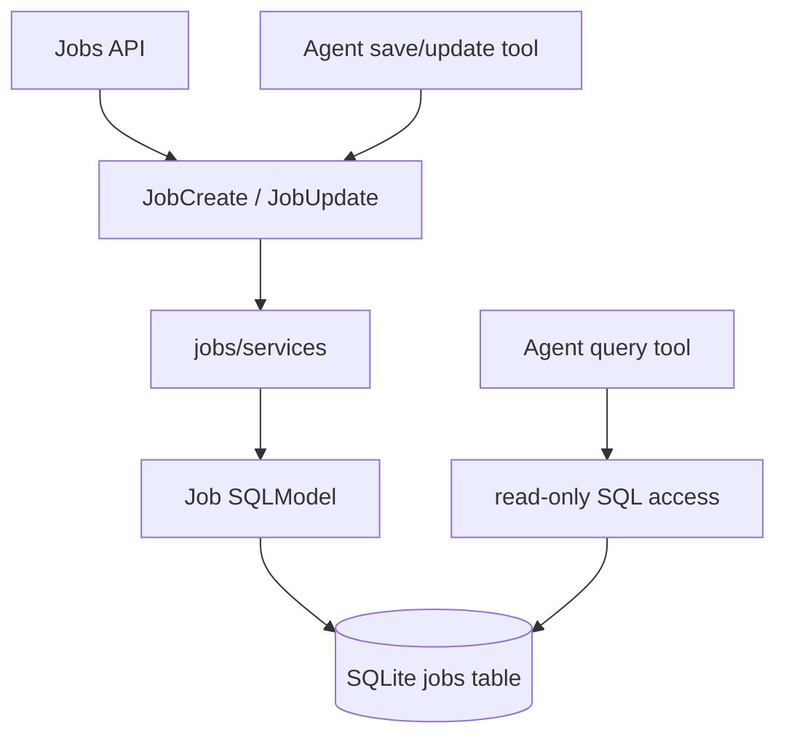

# Data and persistence

## Data stores

| Data | Owner | Storage and lifetime |
| --- | --- | --- |
| Candidate profile | `profile/` | Local ignored JSON file; loaded and validated when fit evaluation runs |
| Tracked jobs | `jobs/` | Local SQLite `jobs` table; current status and notes are stored per job |
| Ashby application drafts and selected files | `applications/` | Process memory and a short-lived browser session (20 minutes); cleared after submit, expiry, or shutdown |
| Conversation history | None | Not persisted by the current backend or agent graph |
| Provider credentials and configuration | `settings.py` | Environment or ignored `.env`; never frontend configuration |

Never add real profile values, resumes, private notes, API keys, or actual local database contents to tracked fixtures or docs. Examples must be synthetic.

## Job write path

Both the HTTP CRUD API and the agent's explicit save/update tools use the same typed contracts and service functions:

`JobCreate` and `JobUpdate` define shared field validation. `jobs/services/jobs.py` owns create/list/get/update operations and translates duplicate or missing-record outcomes into domain exceptions. Routers map those outcomes to HTTP responses; agent tools map them to structured tool results. Neither caller should duplicate persistence logic.

When adding a field or changing a validation rule, update the shared contract, persistence model, both caller surfaces, and focused tests together. Preserve the explicit user-intent requirement for agent writes.

## SQL access for the model

The agent's query tool is an inspection path only. It permits a single `SELECT`, restricts referenced tables to `jobs`, enforces query length and row limits, and opens SQLite read-only. It is not a shortcut for writes. Keep schema descriptions aligned with the `Job` model and tests.

Database sessions used by API routes are short-lived. The process engine is configured centrally by `database.py`; schema initialization currently creates the minimal SQLModel schema at app startup. If migrations or additional tables are introduced, document initialization, upgrade, and rollback behavior before adding them.

## Profile and fit data

The profile is loaded from a local ignored file and validated by the typed profile model. Do not assume omitted fields or preferences. Job facts are represented with explicit evidence and source URLs; unknown values are valid and must not be coerced into matches. Fit output is an LLM assessment over extracted structured facts, not deterministic arithmetic.

Keep profile loading and fit logic behind their existing modules. Do not send profile or note data to a new provider or logging system without documenting the data flow and explicit user-facing behavior.

Implementation entry points: [`profile/loader.py`](../../src/recruiter_agent/profile/loader.py), [`profile/models.py`](../../src/recruiter_agent/profile/models.py), [`jobs/repository.py`](../../src/recruiter_agent/jobs/repository.py), [`jobs/services/schemas.py`](../../src/recruiter_agent/jobs/services/schemas.py), [`jobs/services/jobs.py`](../../src/recruiter_agent/jobs/services/jobs.py), [`jobs/sql_access.py`](../../src/recruiter_agent/jobs/sql_access.py), and [`database.py`](../../src/recruiter_agent/database.py).
