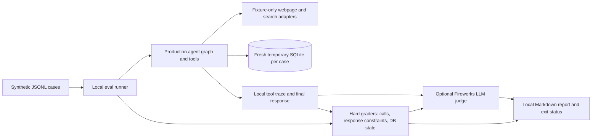

# Evaluations

## Purpose

The eval suite is a local regression tool for agent behavior. Cases describe expected actions and safety constraints rather than one exact natural-language answer. Deterministic checks decide whether required behavior occurred.

## Components and flow

`uv run python -m recruiter_agent.evals` is the only runner command. By default, scripted model responses exercise the production graph, tool wiring, and hard graders without model credentials or network access. The runner prints checks, tool calls/results, and final responses, then writes a readable report to `.eval-results/latest.md`. Webpage/search access is fixture-only, each case receives a temporary SQLite database, and LangSmith tracing is disabled.

Set `EVAL_JUDGE_ENABLED=true` in `.env` to also score the scripted answer with the configured Fireworks model. The judge scores relevance, evidence grounding, and uncertainty calibration from 0 to 2; each dimension must score at least 1. A judge score adds a pass/fail check but cannot override a deterministic hard-check failure. Judge requests contain synthetic case requests, expectations, tool traces, and responses only. This opt-in mode sends data to Fireworks and can incur provider costs.

## Case contract

Cases are newline-delimited JSON in `evals/cases/`; models and validation are in `src/recruiter_agent/evals/models.py`. A case contains:

- A synthetic user request and profile.
- Initial tracked jobs and fixture webpage/search responses.
- Scripted model turns for offline execution.
- Required tool calls with argument subsets, forbidden tools, expected final job rows or an unchanged-database assertion, and short response include/exclude checks.
- At least one hard expectation for tool calls, database state, or response constraints.

Do not require exact prose except for short safety-critical phrases. A case must include at least one hard expectation. Scripted cases exercise tool wiring and graders; they do not measure live model tool selection.

## Scoring semantics

Hard graders are pass/fail. A forbidden tool, wrong database state, missing required call, or failed response constraint fails the case. The optional judge adds subjective answer-quality scores for diagnosis; inspect its rationale alongside the hard checks rather than using the score alone.

The report records each case's pass/fail result, hard checks, observed tool calls and results, final response, and optional judge scores and rationale. It is overwritten at `.eval-results/latest.md` on each run; file permissions are owner-only where supported. `.eval-results/` is ignored by Git.

## Privacy and reproducibility

- Never use real profile values, resumes, personal job URLs, user notes, or production traces in checked-in cases.
- Each case gets a temporary SQLite database. The runner never reads the app's local database or profile file.
- Missing webpage/search fixtures fail closed; fixture adapters do not fall back to the internet.
- The default run is offline and deterministic. Enabling the judge sends only synthetic evaluation data to Fireworks; webpage fixtures never use the network.
- The runner disables LangSmith tracing to prevent a configured tracing environment from exporting evaluation traces.
- Reports contain synthetic case descriptions, tool arguments/results, responses, and optional judge rationale. Keep reports local and review them before sharing.

Implementation entry points: [`evals/README.md`](../../evals/README.md), [`evals/runner.py`](../../src/recruiter_agent/evals/runner.py), [`evals/models.py`](../../src/recruiter_agent/evals/models.py), and [`evals/cases/core.jsonl`](../../evals/cases/core.jsonl).
