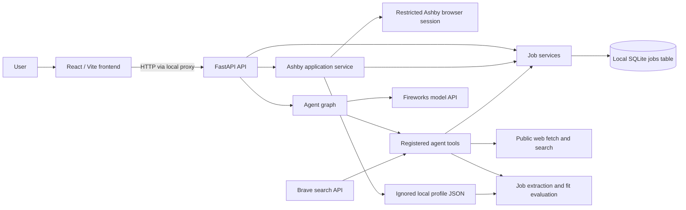

# System overview

## Runtime shape

The application runs as two local development processes: a React/Vite frontend and a FastAPI backend. The browser sends agent input to the backend. During local frontend development, Vite proxies `/api/*` to the backend on loopback. The backend uses local SQLite for the job tracker and calls configured external services for model inference and web search.

## Component ownership

| Component | Owns | Must not own |
| --- | --- | --- |
| `frontend/` | Chat interaction and Ashby answer review/confirmation | Provider credentials, database access, model-driven application submission |
| `src/recruiter_agent/api/` | HTTP routes, request/response validation, HTTP error mapping | Agent policy, SQL construction, persistence rules |
| `src/recruiter_agent/applications/` | Short-lived Ashby form drafts, supported-field mapping, confirmation and one-time submit | Model tool execution, persistent answer storage, arbitrary sites or browser control |
| `src/recruiter_agent/agent/` | One-turn orchestration, system prompt, tool registration, tool-call policy | Raw persistence rules or unrestricted database access |
| `src/recruiter_agent/jobs/` | Job domain types, fit assessment, SQL access boundary, validated persistence services | HTTP response details or provider credentials |
| `src/recruiter_agent/profile/` | Typed profile model and loading the local profile file | Hard-coded personal profile data |
| `src/recruiter_agent/providers/` | Provider-specific HTTP/model integrations and normalized contracts | Product policy or UI behavior |
| `src/recruiter_agent/tools/` | Reusable bounded webpage retrieval and parsing | Agent permission policy or persistence |
| `src/recruiter_agent/database.py` | Engine, sessions, and schema initialization | Domain workflows |

Keep HTTP handling in routers, input/output contracts in schemas, domain behavior in services, and external APIs behind provider or tool boundaries. A module may call inward through those public boundaries; avoid routes or tools that duplicate business validation.

## Request flow

1. The frontend sends a text-only request to `POST /v1/agent/input`.
2. The API validates the request and calls `invoke_agent`.
3. The agent creates a model-backed graph for this turn, registers the tools, and invokes it with the user message. There is no conversation persistence or checkpointing in the current graph.
4. A tool performs a bounded job, such as fetching a public page, searching, evaluating a posting, reading jobs, or making an explicitly requested tracker edit.
5. The backend returns the final assistant text to the frontend. The UI renders assistant output as Markdown.

The API also exposes `/v1/jobs` CRUD endpoints and `/v1/applications` for the separate Ashby review workflow. The application service updates the jobs tracker through shared job services. The agent's save/update tools also use those shared services.

## Change rules

- New cross-component behavior needs a documented owner and a focused contract at the boundary.
- Do not introduce persistence for conversations or agent state without documenting retention, deletion, and privacy behavior.
- Do not expose this unauthenticated API beyond loopback without first designing and implementing an authentication and authorization boundary.
- Update the relevant diagram and ownership table when components or dependencies change.

Implementation entry points: [`main.py`](../../src/recruiter_agent/main.py), [`api/router.py`](../../src/recruiter_agent/api/router.py), [`agent/graph.py`](../../src/recruiter_agent/agent/graph.py), [`database.py`](../../src/recruiter_agent/database.py), and [`frontend/src/App.tsx`](../../frontend/src/App.tsx).
